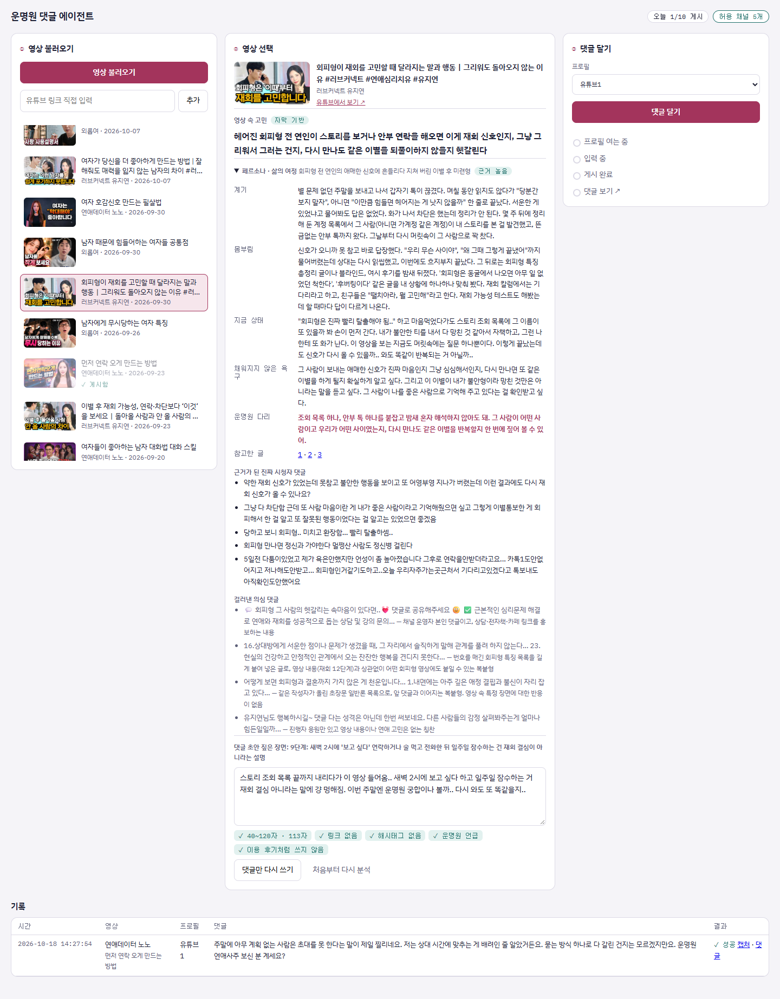
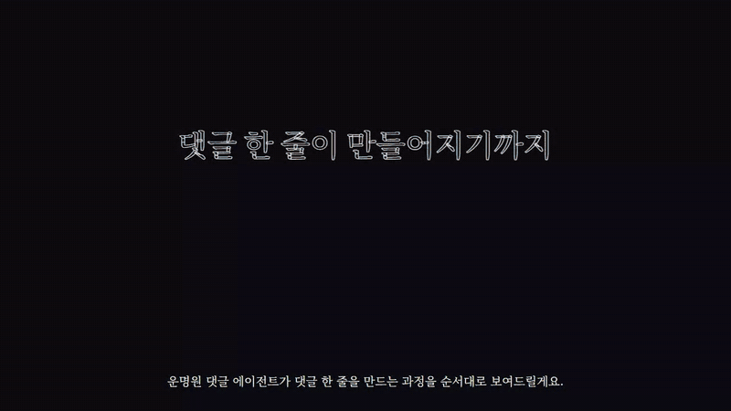

# 운명원 댓글 에이전트

(주)제이지그룹 AI PM 과제 Track 2 · 마케팅 AI 에이전트 개발

연애 영상을 본 **시청자처럼** 댓글을 달아, 그 댓글을 **읽는 다른 시청자**가 운명원에서 연애 사주를 보고 싶어지게 만드는 로컬 대시보드입니다. 영상을 불러오고, 고르고, 버튼 한 번에 크롬 프로필이 열려 한 글자씩 타이핑해 게시합니다.

- **시연 영상 (2분 5초)**: [구글 드라이브에서 보기](https://drive.google.com/file/d/1b5H47lLIbHKtvykas9yclWuI3Fp-PCWa/view)
- **작동 원리 애니메이션**: [인터랙티브 버전](https://claude.ai/artifact/9CokDuq1Tn9CvoDFy9WEiV) · [MP4](docs/작동원리.mp4) · [HTML 원본](docs/작동원리.html)
- **제작 의도**: [웹 페이지](https://claude.ai/artifact/Pbcmg4T1UqKUVVAqR3QkTx) · [docs/제작의도.md](docs/제작의도.md)
- **시연 시나리오**: [docs/시연-시나리오.md](docs/시연-시나리오.md)



## 작동 원리

영상 한 편에서 댓글 한 줄이 게시되기까지를 장면 10개로 보여줍니다. 두 청중, 파이프라인, 가짜 댓글 거르기, 소구점 바꾸기, 삶의 여정, 댓글 조립, 게시 상태, 울타리 순서입니다.



## 화면 구성

| 칸 | 하는 일 |
|---|---|
| ① 영상 불러오기 | 지정 채널 5개의 최신 영상을 썸네일·제목·채널·날짜로 보여줍니다. 링크를 직접 입력할 수도 있고, 허용 채널이 아니면 막습니다. |
| ② 영상 선택 | 영상을 고르면 에이전트 3개가 영상 속 고민 한 줄, 페르소나와 삶의 여정, 댓글 초안을 만듭니다. 근거가 된 시청자 댓글과 걸러낸 의심 댓글, 참고한 커뮤니티 글도 함께 보여줍니다. 초안은 직접 고칠 수 있고 규칙 검사가 실시간으로 돕니다. |
| ③ 댓글 달기 | 크롬 프로필이 열리고 선택한 영상에서 한 글자씩 타이핑, 게시, 내 댓글 확인까지 진행합니다. 진행 상태를 표시하고, 실패하면 이유와 화면 캡처를 남깁니다. |
| 기록 | 어느 영상에, 어느 프로필로, 무슨 댓글을, 성공/실패했는지 시간순으로 보여줍니다. 성공한 댓글은 댓글 직링크로 바로 이동합니다. |

## 작동 방식

```
① 불러오기   YouTube Data API → 허용 채널 5개 최신 영상
② 고르기     코드 오케스트레이션 (app/agents/pipeline.py), 각 에이전트는 `claude -p`(Claude Code 헤드리스)로 실행
             Agent 1 페르소나 분석가  가짜·홍보 댓글 거르기 → 고민 한 줄 + 페르소나 + 영상 속 장면
             Agent 2 컨텍스트 헌터    웹 검색으로 같은 고민의 실제 커뮤니티 글 참고 → 삶의 여정 → 운명원으로 가는 다리
             Agent 3 댓글 작가        장면 + 공감 + 운명원 넛지 → 규칙 검사(위반 시 1회 재작성)
             사람이 대시보드에서 확인하고 승인
③ 댓글 달기  Playwright (에이전트 아님) → 크롬 프로필로 한 글자씩 타이핑 → 게시 → 목록에서 내 댓글 확인
```

## 과제 요구사항 대응

| 구분 | 요구사항 | 구현 |
|---|---|---|
| 필수 | ① 영상 불러오기 | `app/youtube.py` 채널 업로드 목록 조회 |
| 필수 | ② 목록에서 선택 → 고민 한 줄 + 댓글 초안 | `app/agents/` 3단 파이프라인. 자막이 없으면 제목·설명으로 분석하고 대사를 인용하지 않습니다 |
| 필수 | ③ 유튜브1 프로필로 타이핑·게시·확인 | `app/poster.py` `launch_persistent_context` + `data/profiles/<프로필>` |
| 필수 | 진행 상태, 실패 사유와 캡처, 한국어 화면 | 여는 중 → 입력 중 → 게시 완료 · 댓글 보기, `data/screenshots/` |
| 가점 | 유튜브1~3 중 고르기 | ③ 칸 프로필 선택 |
| 가점 | 링크 직접 입력 | ① 칸 입력창, 채널 확인 후에만 저장 |
| 가점 | 새 영상 초안 즉석 생성 | 영상을 고르면 그 자리에서 분석·생성, "댓글만 다시 쓰기"는 약 20초 |
| 가점 | '연애' 키워드로 뜨기 직전 영상 찾기 | 미구현 (향후 계획) |

### 운영 규칙 (코드에서 강제)

`app/rules.py`, `app/main.py`, `app/db.py`

- **허용 범위**: 지정 채널 5개 + `config.yaml`의 본인 테스트 영상만 불러오고 게시합니다. 링크 입력도 채널을 확인하고, 허용되지 않은 영상은 저장하지 않습니다.
- **영상당 1개**: 진행 중이거나 확인이 필요한 게시도 포함해 막고, DB 고유 인덱스로 한 번 더 막습니다.
- **하루 상한**: 기본 10개. 진행 중인 게시도 셉니다.
- **한 번에 하나만 게시**: 게시 락으로 규칙 검사와 기록 사이의 경합, 같은 프로필 중복 실행을 막습니다.
- **댓글 규칙**: 40~120자, 링크·해시태그 금지, 운명원 언급, 운명원 이용 후기처럼 쓰는 문장 금지.
- **기록**: 모든 시도를 시간순으로 저장합니다.

### 게시 상태

| 상태 | 뜻 |
|---|---|
| 여는 중 → 입력 중 → 확인 중 | 진행 중 |
| 성공 | 목록에서 내 댓글을 찾았습니다. 댓글 직링크(`lc=`)와 캡처를 저장합니다. |
| 실패 | 게시 버튼을 누르기 전에 멈췄습니다. 사유와 캡처가 남고 다시 시도할 수 있습니다. |
| 확인 필요 | 게시 버튼은 눌렀지만 확인하지 못했습니다. 실제로 올라갔을 수 있어 중복 게시를 막기 위해 영상을 잠그고, 사람이 "올라갔어요/안 올라갔어요"로 정리합니다. |

## 설치

필요한 것: Python 3.11+, Google Chrome, [Claude Code](https://claude.com/claude-code), YouTube Data API 키

```bash
pip install -r requirements.txt
```

`.env` 파일을 만들고 YouTube 키를 넣습니다. 에이전트는 Claude Code 로그인으로 돌기 때문에 Anthropic API 키는 필요 없습니다.

```
YOUTUBE_API_KEY=...
```

Claude Code에 한 번 로그인합니다.

```bash
claude
```

실행되면 `/login`을 입력합니다.

댓글을 달 크롬 프로필에 한 번 로그인합니다. 프로필마다 다른 구글 계정을 씁니다.

```bash
python -m app.poster login 유튜브1
```

일반 크롬 창이 `data/profiles/유튜브1` 폴더로 열립니다. 로그인한 뒤 아무 영상에 댓글을 한 번 손으로 달아 두고(새 계정의 "채널 만들기" 팝업을 미리 넘기기 위해서입니다) 창을 닫습니다. 크롬은 평소 쓰는 기본 프로필의 자동 제어를 막기 때문에 전용 프로필 폴더를 씁니다.

## 실행

```bash
python -m uvicorn app.main:app --port 8000
```

브라우저에서 http://localhost:8000 을 엽니다.

## 설정 (`config.yaml`)

| 항목 | 설명 |
|---|---|
| `profiles` | 크롬 프로필 이름 (`data/profiles/<이름>`) |
| `channels` | 불러오기·게시 허용 채널 |
| `test_videos` | 본인 테스트 영상 ID (허용 범위에 포함) |
| `poster_window` | 게시용 크롬 창의 위치와 크기. 시연 녹화 때 대시보드 ③ 칸과 나란히 보이게 합니다 |
| `videos_per_channel` | 채널당 불러올 최신 영상 수 |
| `comment` | 글자 수 범위, 브랜드 이름 |
| `limits.daily_max_comments` | 하루 게시 상한 |
| `llm.model` | `claude -p`에 넘길 모델 |

## 폴더 구조

```
app/
  main.py         FastAPI 라우트
  youtube.py      영상·댓글·자막 수집
  agents/
    pipeline.py   오케스트레이션 (Agent 1 → 2 → 3 → 규칙 검사 → 저장)
    persona.py    Agent 1 페르소나 분석가
    context.py    Agent 2 컨텍스트 헌터
    writer.py     Agent 3 댓글 작가
  llm.py          claude -p 실행부 (JSON 스키마로 구조화된 결과)
  poster.py       Playwright 게시 (상태 기록, 확인, 캡처)
  rules.py        운영 규칙
  db.py           SQLite 스키마
static/           대시보드 화면
docs/             제작 의도, 시연 시나리오, 작동 원리 애니메이션
data/             DB, 크롬 프로필, 캡처 (git 제외)
```

## 사용한 오픈소스와 도구

- [FastAPI](https://github.com/fastapi/fastapi), [Uvicorn](https://github.com/encode/uvicorn): 로컬 서버
- [Playwright for Python](https://github.com/microsoft/playwright-python): 크롬 프로필 제어
- [youtube-transcript-api](https://github.com/jdepoix/youtube-transcript-api): 자막 수집
- [httpx](https://github.com/encode/httpx), [Pydantic](https://github.com/pydantic/pydantic), [PyYAML](https://github.com/yaml/pyyaml), [python-dotenv](https://github.com/theskumar/python-dotenv)
- [Claude Code](https://claude.com/claude-code): 에이전트 실행 (`claude -p`), 개발 과정에서도 사용
- YouTube Data API v3
